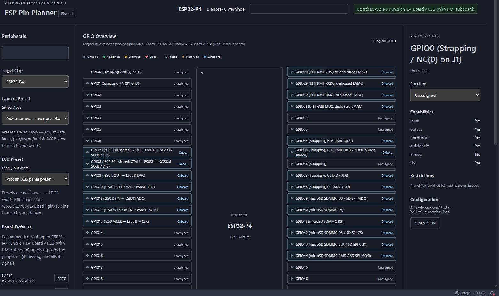
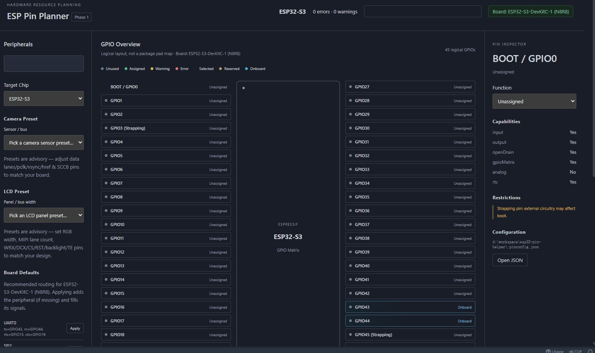
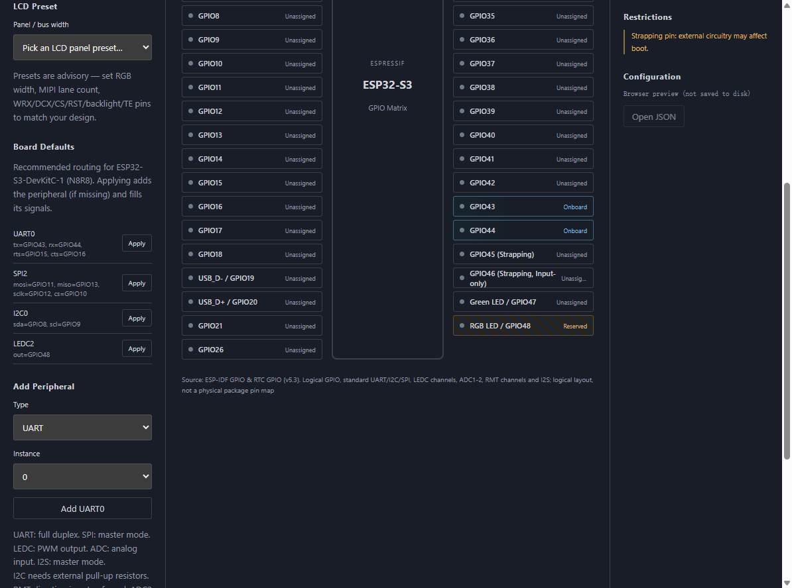
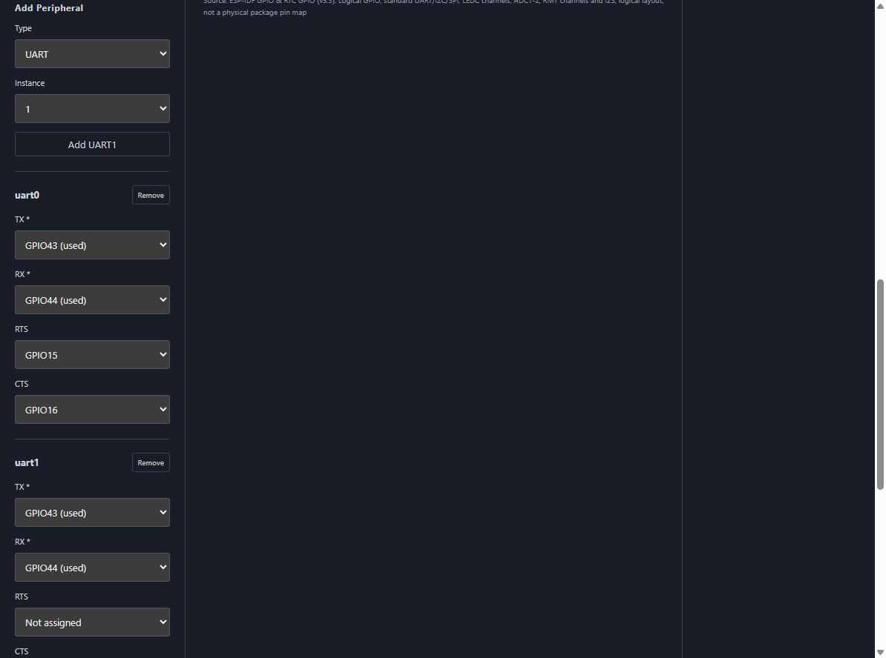
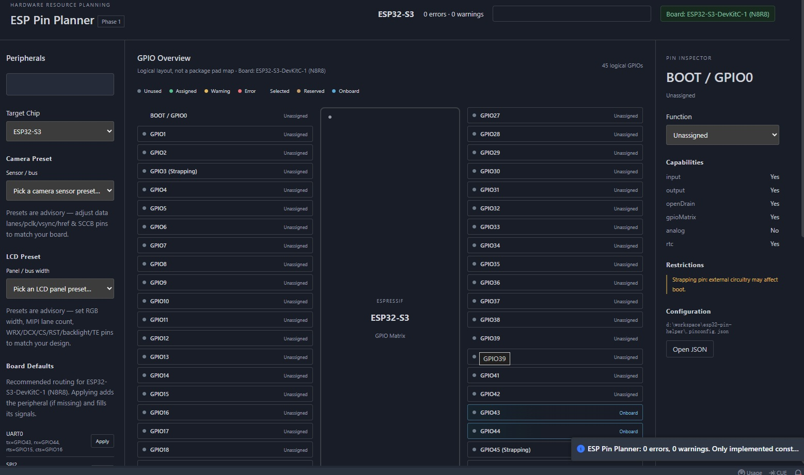

# ESP Pin Planner

> Visual pin / peripheral planning for **ESP32-S3, ESP32-C6 and ESP32-P4** — inside VS Code, without touching your application source code.

ESP Pin Planner is a VS Code extension for ESP-IDF projects. It gives you a live pinout map of the
selected chip, lets you declare peripheral signals (I2C, SPI, UART, I2S, LCD, Camera, …), checks the
hardware constraints that actually bite on ESP32 (GPIO matrix, strapping pins, Flash/PSRAM pins,
USB-JTAG, input-only pins, board-reserved pins) and **auto-assigns a legal pin set** when you don't want
to pick pins by hand.

It deliberately does **not** generate C/C++ code. The single artifact it writes is a human-readable
`.pinconfig.json` file that lives next to your `sdkconfig`.

---

## Highlights

- **Chip-aware pinout** for ESP32-S3 / C6 / P4 with per-pin capability, direction, RTC / analog,
  strapping, memory and USB-JTAG classification.
- **Board profiles** for the official Espressif boards: reserved pins and on-board devices
  (LED, buttons, USB bridge, Flash/PSRAM) are marked so you don't silently break them.
- **Peripheral modelling** for UART, I2C, SPI, I2S, RMT, LEDC, TWAI/CAN, SDMMC, USB-OTG, LCD (MCU/RGB)
  and Camera (DVP).
- **Rule engine** in Problems: signal completeness (Camera), bus-width limits (LCD MCU/RGB),
  USB D+/D− pairing, direction conflicts and reserved-pin reuse.
- **Pin auto-assignment** (`Auto-assign` in the peripheral panel): ranked Top-N plans, scored to prefer
  default routes, avoid strapping / reserved / occupied pins.
- **Per-signal review**: `Accept` a pin to lock it, `Replace` to reject it — the solver re-routes the rest.
- **Candidate highlighting** on the pinout so you can see every recommended GPIO at a glance.

## Screenshots

Open a workspace and run **ESP Pin Planner: Open Pin Planner**:

| Pin planner | Create / select target |
|---|---|
|  |  |

Board defaults and reserved-pin warnings:

| Default routes | On-board warning |
|---|---|
|  |  |

Validation feedback in the Problems panel:



## Getting started

### Install a prebuilt VSIX

```bash
code --install-extension esp-pin-planner-0.0.3.vsix
```

Then open your ESP-IDF project folder and run **ESP Pin Planner: Create New Pin Config** (or
**Open Pin Planner** to work on an existing `.pinconfig.json`).

### From source

```bash
npm install
npm run build      # typecheck + bundle extension + bundle webview
npm test           # unit tests
```

Press <kbd>F5</kbd> in VS Code to launch an Extension Development Host.

## Commands

| Command | ID | What it does |
|---|---|---|
| ESP Pin Planner: Open Pin Planner | `espPinPlanner.open` | Open the pinout / peripheral editor (also available from the editor title bar of `.pinconfig.json`, and as a Quick Fix from a diagnostic). |
| ESP Pin Planner: Create New Pin Config | `espPinPlanner.create` | Create `.pinconfig.json`, pre-selecting the chip detected from `sdkconfig`. |
| ESP Pin Planner: Validate Pin Config | `espPinPlanner.validate` | Re-run all implemented checks and report to the Problems panel. |
| ESP Pin Planner: Select Target Chip | `espPinPlanner.selectTarget` | Switch the target chip; existing assignments are kept and re-checked. |

## Settings

| Setting | Default | Description |
|---|---|---|
| `espPinPlanner.defaultTarget` | `esp32s3` | Target chip used when the project target cannot be detected. |
| `espPinPlanner.schemaStrictInstance` | `true` | Restrict peripheral owner/instance names to the chip-specific set. |
| `espPinPlanner.rmtChannelBank` | `auto` | RMT TX/RX bank preference for S3/C6 (`tx` / `rx` / `auto`). |
| `espPinPlanner.board.preset` | `auto` | Board selection: `auto`, `none`, or `byId`. |
| `espPinPlanner.board.vendor` | `espressif` | Vendor folder under `boards/` when `board.preset = byId`. |
| `espPinPlanner.board.id` | `esp32-s3-devkitc-1` | Board id when `board.preset = byId`. |

## The `.pinconfig.json` file

ESP Pin Planner owns a single root-level file in your workspace:

```json
{
  "version": 1,
  "target": { "chip": "esp32s3" },
  "pins": [
    { "gpio": 8, "function": "GPIO_OPEN_DRAIN" }
  ],
  "peripherals": {
    "i2c0": {
      "type": "i2c",
      "instance": 0,
      "signals": { "sda": "GPIO8", "scl": "GPIO9" }
    }
  }
}
```

- `pins[]` — raw GPIO function assignment (`GPIO_INPUT` / `GPIO_OUTPUT` / `GPIO_OPEN_DRAIN`).
- `peripherals{}` — named peripheral instances and their signal → GPIO routes.
- A JSON schema (`schemas/pinconfig.schema.json`) is registered for live validation and completion in
  the JSON editor, and the extension re-validates on every save / external edit.

## Supported chips & boards

| Chip | Database | Reference boards |
|---|---|---|
| `esp32s3` | ESP32-S3 | ESP32-S3-DevKitC-1 |
| `esp32c6` | ESP32-C6 | ESP32-C6-DevKitC-1, ESP32-C6-DevKitM-1 |
| `esp32p4` | ESP32-P4 | ESP32-P4-Function-EV-Board |

Each chip database records its source documents (TRM chapter + ESP-IDF version) inline.

## Design notes

- **No code generation.** The tool's contract stops at `.pinconfig.json`; wiring your firmware is
  entirely up to you and your ESP-IDF project.
- **Edits are always visible.** Every change made in the WebView is written through the regular VS Code
  document API, so the JSON editor, undo history and your own manual edits stay in sync.
- See [OVERVIEW.md](OVERVIEW.md) for the architecture, data model and the constraint/optimizer design.

## License

[MIT](LICENSE)
